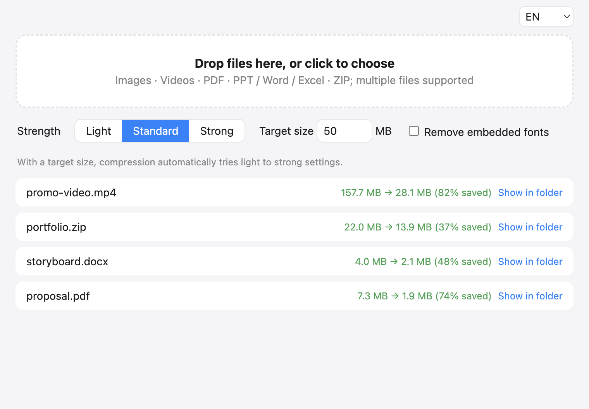

<div align="center">


# Compression Tool

**Drop files in, get them smaller. Images, videos, PDFs, PowerPoint / Word / Excel and ZIP in one window.**

Tell it "under 50 MB" and it finds the lightest setting that gets there.

[中文](README.md) · **English** · [日本語](README.ja.md)

[](https://github.com/Youkou970701/compress-tool/releases/latest)




</div>

## Why

Job applications, tenders, email attachments and upload forms keep saying the same thing: *file must be under 50 MB*.
Online compressors make you upload your files, cap the file size, and need a different site for every format.
This tool puts the common formats in one window and **does everything on your own machine. Your files are never uploaded.**

## Download

Get it from the [Releases page](https://github.com/Youkou970701/compress-tool/releases/latest):

| System | File |
| --- | --- |
| macOS (Apple silicon, M1 and later) | `CompressTool-*-mac-arm64.dmg` |
| Windows 64-bit | `CompressTool-*-win-x64.exe` (installer) or `.zip` (portable) |

Nothing else to install: ffmpeg and Ghostscript are bundled.

<details>
<summary>"Cannot verify the developer" / "is damaged" on first launch?</summary>

The app isn't signed with a paid developer certificate, so the OS warns you once. This is expected.

- **macOS**: right-click the app → Open → Open. If it still says the app is damaged, run this in Terminal:
  `xattr -dr com.apple.quarantine /Applications/压缩工具.app`
- **Windows**: in the SmartScreen dialog, click "More info" → "Run anyway".

</details>

## How to use

1. Drag files into the window (as many as you like), or click to choose.
2. Pick a level: **Light / Standard / Strong**.
3. Need a hard limit? Enter a **target size**, e.g. `50`. It tries each level from light to strong and stops at the first one that fits.
4. The result is saved next to the original as `name-compressed.ext`. **The original is never overwritten.** If a file can't be made smaller, no new file is written and you're told why.

## How each format is compressed

| Type | Method |
| --- | --- |
| Images `jpg` `png` `webp` `heic` | Re-encoded, downscaled if needed; `heic` is saved as `jpg` |
| Videos `mp4` `mov` `mkv` `avi` `webm` | Re-encoded to H.264. With a target size, the **bitrate is calculated from the video length** and the resolution steps down with it |
| PDF | Rebuilt with Ghostscript at a lower resolution for embedded images |
| PowerPoint / Word / Excel / ZIP | Unpacked, **the images and videos inside are recompressed**, then repacked. Text and layout stay untouched. Embedded fonts can optionally be removed |

### Real-world results

| File | Before | After | Notes |
| --- | --- | --- | --- |
| Promo video `.mp4` | 157.7 MB | 28.1 MB | Target 30 MB |
| Portfolio `.zip` | 22.0 MB | 13.9 MB | Standard; videos inside the ZIP were compressed too |
| Storyboard `.docx` | 4.0 MB | 2.1 MB | Standard |
| Proposal `.pdf` | 7.3 MB | 1.9 MB | Strong (Standard only reached 6.5 MB) |

> How much you save depends on the file. Files that are already tightly compressed, or PDFs that are mostly text, won't shrink much. That's normal.

## Good to know

- Compression is **lossy**: images and videos lose some quality. Keep your originals; the tool never modifies them.
- If the target size is very small, videos will look noticeably blurry. When the target can't be reached, the tool says so instead of pretending.
- Video compression is CPU-heavy. Large files take anywhere from tens of seconds to a few minutes.

## Run from source

```bash
git clone https://github.com/Youkou970701/compress-tool.git
cd compress-tool
npm install
npm start
```

PDF compression needs Ghostscript. On macOS, `brew install ghostscript` is enough for development (release builds bundle it).

Test the compression core from the command line:

```bash
node scripts/test.mjs <file> [light|medium|strong] [targetMB]
```

## Tech stack

Electron · [sharp](https://sharp.pixelplumbing.com/) (images) · [ffmpeg](https://ffmpeg.org/) (video) · [Ghostscript](https://ghostscript.com/) (PDF) · [JSZip](https://stuk.github.io/jszip/) (Office / ZIP)

Releases are built by GitHub Actions: pushing a `v*` tag builds on macOS and Windows and publishes to Releases.

## License

This project bundles third-party components including Ghostscript (AGPL) and ffmpeg (GPL/LGPL). Please follow their respective licenses.
