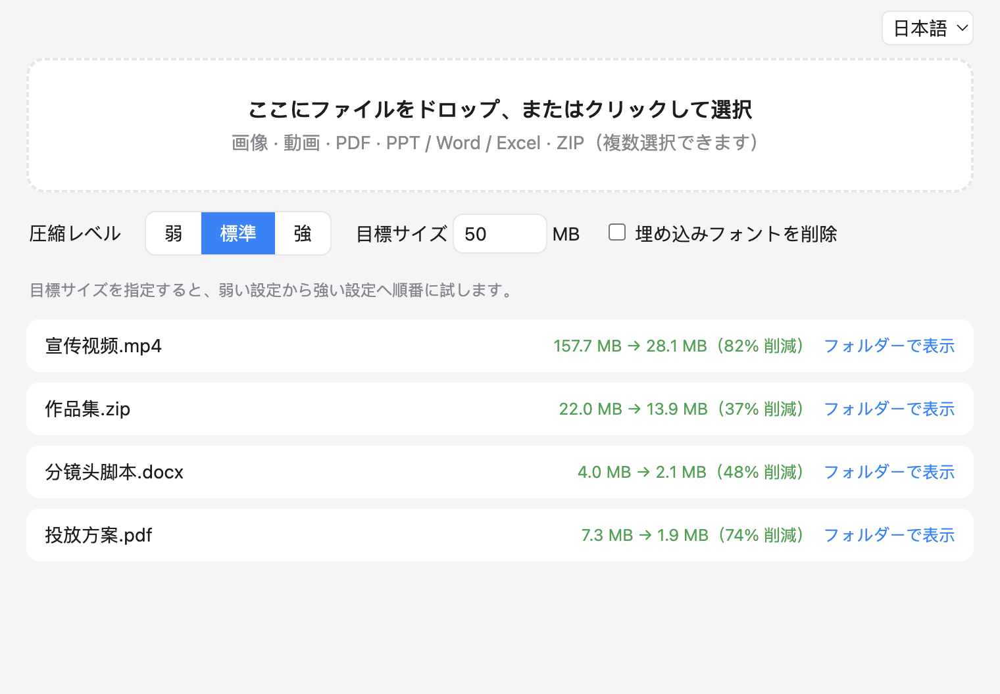

<div align="center">


# 圧縮ツール

**ドラッグするだけで小さく。画像・動画・PDF・PowerPoint / Word / Excel・ZIP をひとつのウィンドウで。**

「50 MB 以下」と指定すれば、それを満たすいちばん軽い設定を自動で探します。

[中文](README.md) · [English](README.en.md) · **日本語**

[](https://github.com/Youkou970701/compress-tool/releases/latest)




</div>

## なぜ作ったか

応募書類、入札資料、メール添付、各種アップロードフォーム。どこでも「ファイルは 50 MB 以下」と言われます。
オンラインの圧縮サイトはファイルをアップロードする必要があり、サイズ制限があり、形式ごとに別のサイトを探さなければなりません。
このツールはよく使う形式をひとつのウィンドウにまとめ、**すべての処理を自分のパソコンの中で完結させます。ファイルが外部に送られることはありません。**

## ダウンロード

[Releases ページ](https://github.com/Youkou970701/compress-tool/releases/latest) から：

| OS | ファイル |
| --- | --- |
| macOS（Apple シリコン、M1 以降） | `CompressTool-*-mac-arm64.dmg` |
| Windows 64 ビット | `CompressTool-*-win-x64.exe`（インストーラー）または `.zip`（インストール不要） |

ffmpeg と Ghostscript は同梱済みなので、ほかに入れるものはありません。

<details>
<summary>初回起動で「開発元を確認できません」「壊れています」と表示される場合</summary>

有料の開発者署名をしていないため、初回に OS が警告を出します。異常ではありません。

- **macOS**：アプリを右クリック →「開く」→ もう一度「開く」。それでも「壊れています」と出る場合は、ターミナルで次を実行してください：
  `xattr -dr com.apple.quarantine /Applications/压缩工具.app`
- **Windows**：SmartScreen の画面で「詳細情報」→「実行」。

</details>

## 使い方

1. ファイルをウィンドウにドラッグします（複数可）。クリックして選ぶこともできます。
2. 強さを選びます：**弱 / 標準 / 強**。
3. サイズの上限があるなら**目標サイズ**を入力します（例：`50`）。弱い設定から順に試し、条件を満たした時点で止まります。
4. 結果は元のファイルと同じ場所に `元の名前-圧縮.拡張子` として保存されます。**元のファイルは上書きしません。** 小さくできなかったファイルは新しく作らず、その理由を表示します。

## 形式ごとの圧縮方法

| 種類 | 方法 |
| --- | --- |
| 画像 `jpg` `png` `webp` `heic` | 再エンコードし、必要なら解像度を下げます。`heic` は `jpg` で保存 |
| 動画 `mp4` `mov` `mkv` `avi` `webm` | H.264 で再エンコード。目標サイズを指定すると、**動画の長さからビットレートを逆算**し、解像度もそれに合わせて下げます |
| PDF | Ghostscript で作り直し、埋め込み画像の解像度を下げます |
| PowerPoint / Word / Excel / ZIP | 展開して**中の画像と動画を再圧縮**し、元どおりにまとめ直します。文書の内容とレイアウトは変わりません。埋め込みフォントを削除するオプションもあります |

### 実測

| ファイル | 圧縮前 | 圧縮後 | 備考 |
| --- | --- | --- | --- |
| プロモーション動画 `.mp4` | 157.7 MB | 28.1 MB | 目標 30 MB |
| ポートフォリオ `.zip` | 22.0 MB | 13.9 MB | 標準。ZIP 内の動画も圧縮 |
| 絵コンテ `.docx` | 4.0 MB | 2.1 MB | 標準 |
| 企画書 `.pdf` | 7.3 MB | 1.9 MB | 強（標準では 6.5 MB まで） |

> どれだけ小さくなるかはファイル次第です。すでに強く圧縮されたファイルや、文字中心の PDF はあまり小さくなりません。これは正常な動作です。

## 注意

- 圧縮は**非可逆**です（画像や動画の画質は下がります）。大切な元ファイルは残しておいてください。ツールが元ファイルを変更することはありません。
- 目標サイズを小さくしすぎると、動画は目に見えてぼやけます。目標に届かない場合は、成功したふりをせずにはっきり伝えます。
- 動画の圧縮は CPU を多く使います。大きなファイルは数十秒から数分かかります。

## ソースから実行

```bash
git clone https://github.com/Youkou970701/compress-tool.git
cd compress-tool
npm install
npm start
```

PDF の圧縮には Ghostscript が必要です。macOS では `brew install ghostscript` で開発時も使えます（配布版には同梱済み）。

コマンドラインで圧縮処理だけを試す：

```bash
node scripts/test.mjs <ファイル> [light|medium|strong] [目標MB]
```

## 技術スタック

Electron · [sharp](https://sharp.pixelplumbing.com/)（画像）· [ffmpeg](https://ffmpeg.org/)（動画）· [Ghostscript](https://ghostscript.com/)（PDF）· [JSZip](https://stuk.github.io/jszip/)（Office / ZIP）

リリースは GitHub Actions で自動化しています。`v*` タグを push すると、macOS と Windows でビルドして Releases に公開します。

## ライセンス

本プロジェクトは Ghostscript（AGPL）や ffmpeg（GPL/LGPL）などのサードパーティ製コンポーネントを含みます。それぞれのライセンスに従ってください。
